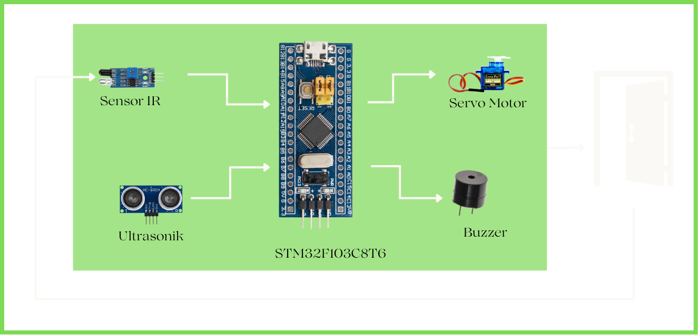
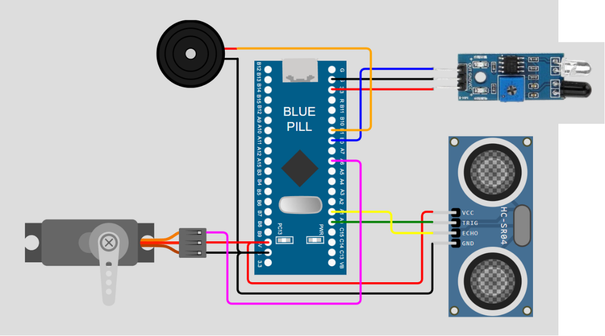
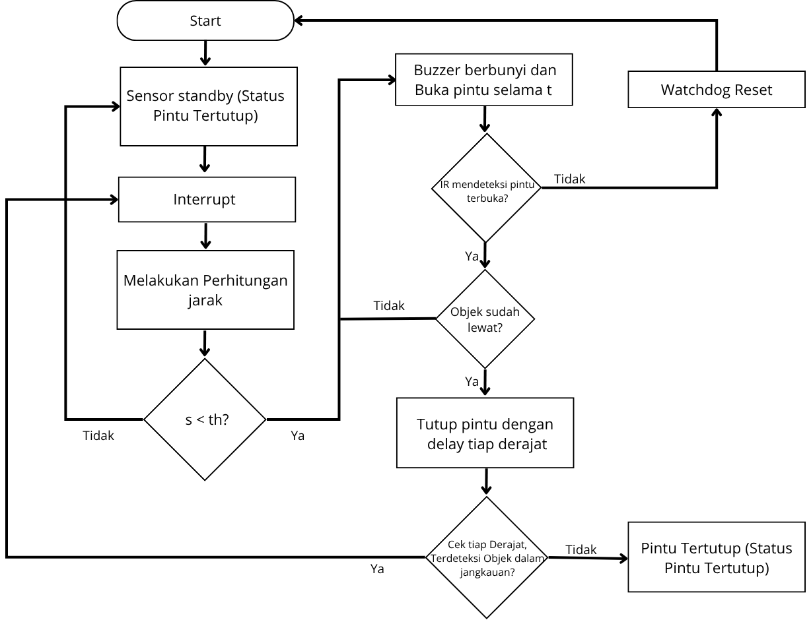

# STM32 Automatic Door System

## Overview
This project is a group project developed as assessment of an Embedded System subject. It implements an automatic door system using an STM32 microcontroller, with a focus on applying fundamental embedded systems concepts.

The project incorporates external interrupts, timers and counters, SysTick-based delay, and watchdog functionality to demonstrate the use of microcontroller peripherals in embedded application.

## Key Features an Concepts
1. Interrupt-driven event handling
2. Timer and counter configuration
3. SysTick-based delay implementation
4. Watchdog timer implementation
5. Servo motor control
6. Buzzer integration
7. IR sensor integration

## Hardware and Software
1. Microcontroller: STM32F103C8T6
2. Development Environment: STM32 Cube IDE
3. Hardware Components: Micro Servo MG90S, Ultrasonic Sensor HC-SR04, IR Sensor, Buzzer

## System Diagram

## Wiring

## How it Works

## Demo

## My Contribution
Played a major role in the firmware implementation of the automatic door system, with responsibilities including:
1. Interrupt Handling: Implemented interrupt handling as part of the systems's control logic
2. Servo Motor Control: Worked on controlling servo motor movement for the automatic door mechanism
3. Buzzer Integration: Implemented the buzzer functionality as part of the system
4. Firmware Integration: Contributed to integrating the control logic and hardware functionality within the STM32-based system
